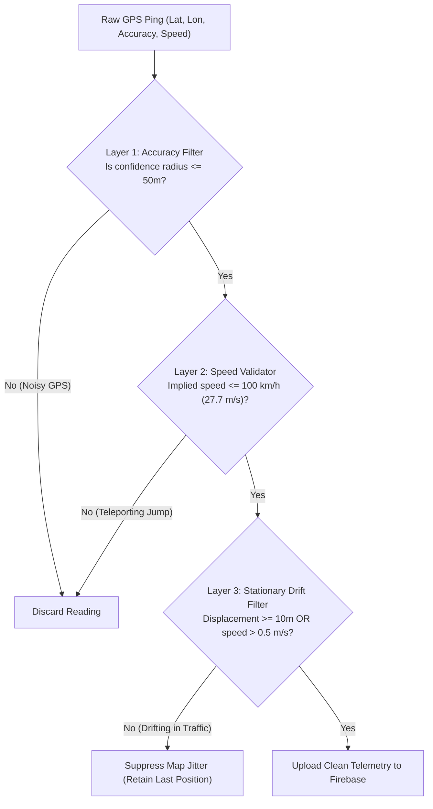
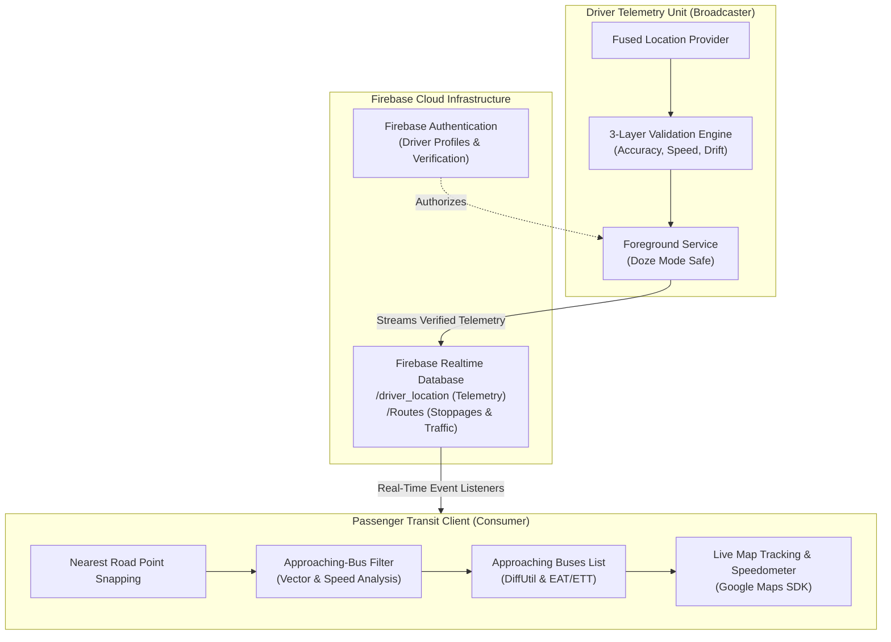

# 🚌 Jatra (যাত্রা) - Smart City Bus Tracking & Navigation System

[](https://developer.android.com/)
[](https://www.java.com/)
[](https://firebase.google.com/)
[](https://developers.google.com/maps)
[](https://gradle.org/)
[](https://www.ewubd.edu/)
[](https://opensource.org/licenses/MIT)

**Jatra** (*"যাত্রা"* meaning *Journey* in Bengali) is an intelligent, real-time public and private transit tracking and navigation ecosystem engineered to modernize urban public transit in Dhaka, Bangladesh. Developed as a Computer Science & Engineering Capstone Project at **East West University (EWU)**, Jatra unifies the **Driver-Side Telemetry Unit** and the **Passenger-Side Transit Radar** into an integrated, end-to-end smart transit platform.

---

## 📌 Table of Contents

- [Overview & Ecosystem Architecture](#-overview--ecosystem-architecture)
- [System Roles & Core Features](#-system-roles--core-features)
  - [1. Driver-Side Telemetry Unit](#1-driver-side-telemetry-unit)
  - [2. Passenger-Side Transit Radar](#2-passenger-side-transit-radar)
- [Core Algorithms & Data Integrity](#-core-algorithms--data-integrity)
  - [3-Layer GPS Validation Algorithm (Driver)](#1-3-layer-gps-validation-algorithm-driver-side)
  - [Approaching-Bus Verification (Passenger)](#2-approaching-bus-verification-passenger-side)
  - [Dynamic ETA & ETT Estimation](#3-dynamic-eta-and-ett-estimation)
- [Engineering Challenges Solved](#-engineering-challenges-solved)
- [System Architecture & Data Flow](#-system-architecture--data-flow)
- [Database Schema (Firebase)](#-database-schema-firebase)
- [Tech Stack & Dependencies](#-tech-stack--dependencies)
- [Project Directory Structure](#-project-directory-structure)
- [⚙️ Setup & Installation Guide](#️-setup--installation-guide)
  - [Prerequisites](#1-prerequisites)
  - [Clone Repository](#2-clone-the-repository)
  - [Open Project in Android Studio](#3-open-project-in-android-studio)
  - [Firebase Configuration](#4-firebase-configuration)
  - [Google Maps API Key](#5-google-maps-api-key-configuration)
  - [Build and Run](#6-build-and-run-the-application)
- [Permissions & Security](#-permissions--security)
- [Future Scope & Roadmap](#-future-scope--roadmap)
- [👥 Collaborators (Capstone Team)](#-collaborators)
- [🐛 Bug Reporting & Support](#-bug-reporting--support)
- [📄 License](#-license)

---

## 📖 Overview & Ecosystem Architecture

In dense metropolitan cities like Dhaka, unpredictable road congestion and irregular transit schedules cause passengers to waste extensive time waiting at bus stops with no visibility into vehicle arrival times. Simultaneously, raw GPS data collected in urban environments suffers from significant multipath interference, satellite blockage from skyscrapers, and network-induced location "teleportation."

**Jatra** addresses these challenges through a unified two-sided ecosystem:
1. **Driver-Side Telemetry Broadcaster**: Turns any driver's smartphone into a low-power, high-accuracy transit telemetry beacon. It applies a 3-layer filtering pipeline to clean raw GPS data on-device before streaming updates to Firebase Realtime Database.
2. **Passenger-Side Navigation Client**: Automatically snaps commuters to their nearest transit stop, filters active fleet units to only show buses actively approaching their boarding point, and provides live Google Maps tracking with dynamic arrival estimates (EAT / ETT).
3. **Cloud Infrastructure**: Powered by Google Firebase (Realtime Database for sub-second location propagation and Firebase Authentication for driver identity and route management).

---

## 🚀 System Roles & Core Features

### 1. Driver-Side Telemetry Unit
- **Continuous Telemetry Broadcasting**: Captures and uploads real-time latitude, longitude, speed ($m/s$), bearing, and timestamps directly to the Firebase Realtime Database.
- **3-Layer Sensor Data Validation**: Scrubs GPS readings on-device before transmission, discarding noisy readings, teleporting coordinates, and stationary map jitter.
- **Driver Verification & Route Linking**: Authenticates drivers and securely links each vehicle to its designated transit corridor via Firebase Authentication.
- **Status & Privacy Management**: Provides quick **"On-Duty"** and **"Off-Duty"** toggles so drivers can suspend tracking during breaks, shift changes, or personal use.
- **Background Execution**: Operates as a persistent Android **Foreground Service** with high-priority status notifications, preventing Android Doze Mode from killing location broadcasts.

### 2. Passenger-Side Transit Radar
- **Smart Nearest-Stop Snapping**: Automatically detects passenger coordinates using `FusedLocationProviderClient` and snaps them to the nearest stop along registered transit corridors.
- **Approaching Bus Radar**: Filters fleet units within a 15 km catchment radius to isolate only those buses moving towards the user's boarding point.
- **Interactive Google Maps Live View (`RouteMapActivity`)**:
  - **Adaptive Markers**: Vehicle markers dynamically change color and icon state based on whether the bus is approaching or traveling away.
  - **Polyline Route Tracing**: Draws the corridor path connecting the bus and passenger, including dashed connector lines from off-route positions to the nearest road segment.
  - **Live Telemetry Dashboard**: Shows real-time speed in km/h, freshness timestamp of the last GPS ping, distance remaining, and connection health (Active / Inactive / Offline).
- **Dynamic ETA (Estimated Arrival Time) & ETT (Estimated Travel Time)**: Live trip calculations based on actual vehicle speeds and remaining route geometry.
- **Complete Fleet Directory (`ShowAllPrivateBus`)**: Searchable directory displaying all registered vehicles, active/inactive status badges (🟢 / 🔴), driver phone numbers, and one-tap turn-by-turn navigation via Google Maps.

---

## 🧠 Core Algorithms & Data Integrity

### 1. 3-Layer GPS Validation Algorithm (Driver Side)
To ensure data integrity and avoid erratic map jumps on commuter screens, raw GPS sensor feeds pass through three progressive filtering gates:



1. **Layer 1: Accuracy Filter**: Discards any GPS fix with a horizontal confidence radius $> 50\text{ meters}$, eliminating erroneous multipath reflections caused by urban structures.
2. **Layer 2: Speed Validator**: Applies physical velocity constraints. Updates where implied delta speed exceeds $100\text{ km/h}$ ($27.7\text{ m/s}$) are rejected to eliminate cell-tower/Wi-Fi triangulation "teleporting."
3. **Layer 3: Stationary Drift Filter**: Ignores micro-movements ($< 10\text{ meters}$) when the vehicle is stopped in traffic, preventing the bus icon from "dancing" around the map.

---

### 2. Approaching-Bus Verification (Passenger Side)
To eliminate buses running in reverse or vehicles that have already passed the boarding stop, the passenger app evaluates sequential GPS fixes ($P_{t_0}, P_{t_1}, P_{t_2}$):

$$\text{isApproaching} = \begin{cases} 
\text{true} & \text{if } d(P_{t_2}, P_{target}) < d(P_{t_1}, P_{target}) < d(P_{t_0}, P_{target}) \\ 
\text{false} & \text{otherwise} 
\end{cases}$$

A vehicle is only admitted into the approaching list if:
$$\text{distanceToStart} < \text{distanceToEnd} \quad \text{and} \quad \text{distanceToStart} \le 15.0\text{ km}$$

---

### 3. Dynamic ETA and ETT Estimation
Using the segment-interpolated polyline distance $D_{route}$ (meters) and the current average vehicle velocity $v$ ($m/s$):

$$\text{ETA (minutes)} = \max \left(1, \; \left\lfloor \frac{D_{route \to start}}{\max(v_{actual}, v_{min})} \times \frac{1}{60} \right\rfloor \right)$$

where $v_{min} = 1.5\text{ m/s}$ (fallback speed during heavy traffic to prevent division by zero).

---

## ⚡ Engineering Challenges Solved

| Challenge | Root Cause | Engineering Solution in Jatra |
| :--- | :--- | :--- |
| **Battery Drain** | Continuous high-frequency GPS queries exhaust phone batteries during 8–10 hour driving shifts. | Tuned `FusedLocationProviderClient` update intervals and priority levels to balance tracking precision with power consumption. |
| **Android Doze Mode & Background Kills** | Android OS terminates background services and throttles location sensors when the screen turns off. | Implemented a high-priority Android **Foreground Service** with persistent system notification and `FOREGROUND_SERVICE_LOCATION` permission. |
| **GPS Teleporting** | Network switching between cell towers and Wi-Fi networks generates wild coordinate anomalies. | Built the **3-Layer Validation Algorithm** with physics-based speed validator to discard invalid coordinate leaps. |
| **UI Stutter Under High Data Rates** | Frequent Firebase push callbacks trigger excessive RecyclerView re-binds. | Implemented background processing using `ExecutorService` and throttled UI updates with a 1000ms debounce loop paired with `DiffUtil`. |

---

## 🏗️ System Architecture & Data Flow



---

## 🗄️ Database Schema (Firebase)

### 1. `driver_location/` (`private_bus` / `public_bus`)
Stores active vehicle metadata and time-series GPS fixes:
```json
{
  "driver_location": {
    "private_bus": {
      "BUS001": {
        "status": "active",
        "Bus_Info": {
          "driverName": "Mohammad Rahim",
          "mobile": "+8801700000000",
          "from": "Rampura",
          "to": "Uttara",
          "busName": "Anabil Express"
        },
        "locations": {
          "-Nxyz123abc": {
            "lat": 23.771234,
            "lon": 90.423456,
            "speed": 8.5,
            "timestamp": 1732320000000
          }
        }
      }
    }
  }
}
```

### 2. `Routes/`
Stores ordered route nodes and historical traffic conditions:
```json
{
  "Routes": {
    "Rampura_to_Uttara": {
      "stop_01": {
        "SerialNo": 1,
        "PlaceName": "Rampura Bridge",
        "Latitude": "23.761234",
        "Longitude": "90.421567",
        "Traffic8am": "Heavy",
        "Traffic12pm": "Moderate",
        "Traffic4pm": "Heavy",
        "Traffic8pm": "Moderate"
      },
      "stop_02": {
        "SerialNo": 2,
        "PlaceName": "Badda",
        "Latitude": "23.780123",
        "Longitude": "90.426789"
      }
    }
  }
}
```

---

## 🛠️ Tech Stack & Dependencies

| Category | Component / Library | Details |
| :--- | :--- | :--- |
| **Language** | Java (JDK 11) | Core Android native business logic |
| **SDK Levels** | Min SDK 26 • Target SDK 34 • Compile SDK 35 | Compatible with Android 8.0 through Android 15 |
| **Build System** | Gradle 8.7.3 & Android Gradle Plugin | Gradle Kotlin DSL (`build.gradle.kts`) with version catalog |
| **Cloud Backend** | Firebase Realtime Database (`21.0.0`) | High-speed, low-latency live GPS coordinate syncing |
| **Authentication** | Firebase Authentication | Driver identity verification & route permission assignment |
| **Maps & Geo** | Google Play Services Maps (`19.2.0`) | Real-time vector map rendering, dynamic markers, camera animations |
| **Location Services** | Google Play Services Location (`21.3.0`) | `FusedLocationProviderClient` for battery-aware GPS fixes |
| **Background Tasks** | Android Foreground Service | Continuous location streaming unaffected by Android Doze Mode |
| **UI Framework** | Google Material Components (`1.12.0`) | Material Design 3, ConstraintLayout, CardViews, ListAdapter |
| **Utility** | Apache Commons Lang3 (`3.12.0`) | Data structures & utility helpers |

---

## 📁 Project Directory Structure

```text
CapstoneBus/
├── app/
│   ├── build.gradle.kts                   # Module build configuration & dependencies
│   ├── google-services.json               # Firebase configuration file
│   └── src/
│       └── main/
│           ├── AndroidManifest.xml        # Permissions, Activities, and Services
│           ├── java/com/example/capstonebus/
│           │   ├── MainActivity.java            # Main dashboard & transit mode selector
│           │   ├── Search_activity.java         # Boarding/Destination stop selection & auto-snap
│           │   ├── Search_bar_activity.java     # Searchable autocomplete for transit stoppages
│           │   ├── CurrentLocationActivity.java # Map & list-based location selector
│           │   ├── Buss_List_privatebus.java    # Approaching bus list with live polling & filtering
│           │   ├── ShowAllPrivateBus.java       # Comprehensive fleet overview screen
│           │   ├── RouteMapActivity.java        # Full Google Maps live tracking with telemetry
│           │   ├── RouteMapActivityPrivate.java # Single-bus live tracker view
│           │   ├── BusTrackingListAdapter.java  # High-performance DiffUtil RecyclerView adapter
│           │   ├── PrivateBusAdapter.java       # Fleet directory RecyclerView adapter
│           │   ├── Businfo.java                 # Model: GPS fix data (lat, lon, speed, timestamp)
│           │   ├── BusRoute.java                # Model: Stoppage coordinates and traffic stats
│           │   ├── BusDriverInfo.java           # Model: Driver & route metadata
│           │   ├── BusTrackingData.java         # Model: Aggregated tracking DTO for list cards
│           │   ├── PrivateBus.java              # Model: Fleet vehicle DTO
│           │   └── passengerLocation.java       # Model: Passenger coordinate DTO
│           └── res/
│               ├── layout/                # XML layouts for screens & list items
│               ├── drawable/              # Custom map markers, icons, and gradients
│               ├── raw/                   # Video assets & animations (mp4)
│               └── values/                # Strings, colors, styles, themes
├── gradle/
│   └── libs.versions.toml                 # Centralized dependency catalog
├── build.gradle.kts                       # Root build configuration
├── settings.gradle.kts                    # Project modules & repository settings
└── README.md                              # Project documentation
```

---

## ⚙️ Setup & Installation Guide

Follow these step-by-step instructions to set up, build, and run the project locally.

### 1. Prerequisites
- **Android Studio**: Install [Android Studio Ladybug (2024.2.1+)](https://developer.android.com/studio) or newer.
- **Java Development Kit**: JDK 11 or JDK 17 configured in Android Studio.
- **Android SDK**: Android SDK Platform 34 or 35 installed via the SDK Manager.
- **Test Device / Emulator**:
  - Physical Android device running Android 8.0 (API level 26) or higher with **Developer Options** and **USB Debugging** enabled (recommended for live GPS testing).
  - Or an Android Virtual Device (AVD) with **Google Play Services** enabled.

---

### 2. Clone the Repository
Clone the project repository to your local machine using Git:

```bash
git clone https://github.com/enamulhasan248/Jatra-A-Smart-City-Bus-Tracking-Navigation-System.git
```

Navigate into the cloned directory:
```bash
cd Jatra-A-Smart-City-Bus-Tracking-Navigation-System
```
*(Note: If opening the project from this repository directory directly, the root Android project is located under `CapstoneBus/`)*.

---

### 3. Open Project in Android Studio
1. Launch **Android Studio**.
2. Select **Open** (or **File > Open**).
3. Browse to the project folder (`CapstoneBus/` or the cloned root) and click **OK**.
4. Allow Android Studio to complete the initial indexing and Gradle configuration.

---

### 4. Firebase Configuration
The application relies on Firebase for real-time location syncing and driver management.

1. Verify that `google-services.json` is present in the `app/` directory:
   ```text
   CapstoneBus/app/google-services.json
   ```
2. If connecting your own Firebase project:
   - Go to the [Firebase Console](https://console.firebase.google.com/).
   - Create a project (or select an existing one) and register an Android app with package name:
     ```text
     com.example.capstonebus
     ```
   - Download the generated `google-services.json`.
   - Place it inside `CapstoneBus/app/` replacing any placeholder file.
   - Enable **Firebase Realtime Database** in test or production mode.
   - (Optional for driver management) Enable **Firebase Authentication** (Email/Password or Phone Auth).

---

### 5. Google Maps API Key Configuration
The app requires a Google Maps API Key with the **Maps SDK for Android** enabled.

1. Go to the [Google Cloud Console](https://console.cloud.google.com/).
2. Enable **Maps SDK for Android** for your project.
3. Generate an API Key under **APIs & Services > Credentials**.
4. Configure the key in the project using one of the following methods:

   **Method A (Recommended - via `local.properties`):**
   Open or create `CapstoneBus/local.properties` and add:
   ```properties
   MAPS_API_KEY=AIzaSy...YourActualApiKeyHere...
   ```

   **Method B (Directly in `AndroidManifest.xml`):**
   Open `app/src/main/AndroidManifest.xml` and update the metadata tag:
   ```xml
   <meta-data
       android:name="com.google.android.geo.API_KEY"
       android:value="AIzaSy...YourActualApiKeyHere..." />
   ```

---

### 6. Build and Run the Application
1. In Android Studio, click **Sync Project with Gradle Files** (elephant icon or `File > Sync Project with Gradle Files`).
2. Verify that all dependencies resolve without errors.
3. Connect your Android device via USB (or launch your emulator).
4. Select the `app` run configuration in the top toolbar.
5. Click the green **Run** button (or press `Shift + F10`).
6. Grant location permissions when prompted on the device.

---

## 🔒 Permissions & Security

The app declares the following permissions in `AndroidManifest.xml`:

| Permission | Justification |
| :--- | :--- |
| `android.permission.INTERNET` | Streams real-time GPS telemetry to Firebase and loads Google Maps tiles |
| `android.permission.ACCESS_FINE_LOCATION` | Required for high-accuracy GPS coordinates for driver and passenger positioning |
| `android.permission.ACCESS_COARSE_LOCATION` | Fallback approximate cell-tower / Wi-Fi positioning |
| `android.permission.ACCESS_NETWORK_STATE` | Checks network connection state before syncing |
| `android.permission.FOREGROUND_SERVICE` | Enables continuous driver tracking service without Android Doze Mode kills |
| `android.permission.FOREGROUND_SERVICE_LOCATION` | Specific Android 14+ requirement for foreground location tracking |
| `android.permission.ACCESS_BACKGROUND_LOCATION` | Allows seamless location telemetry when app is minimized |

---

## 🔮 Future Scope & Roadmap

- [ ] **Passenger Crowdsourcing / Seat Occupancy**: Enable drivers or commuters to broadcast live bus occupancy levels (Vacant, Moderate, Standing Room Only).
- [ ] **Predictive Machine Learning for Delay Estimation**: Train ML models on historic time-slot traffic segments (`Traffic8am`, `Traffic12pm`, `Traffic4pm`, `Traffic8pm`) to predict transit bottlenecks before they occur.
- [ ] **Digital Fare Payment**: Integrate local Mobile Financial Services (bKash, Nagad, Rocket) and QR code scanners for cashless ticketing.
- [ ] **Driver Trip Management**: Automated trip dispatch, shift completion summaries, and route adherence alerts.
- [ ] **Bilingual Interface**: Full localization supporting Bengali (বাংলা) and English.

---

## 👥 Collaborators

This project was developed as an Undergraduate Capstone Project by four Computer Science and Engineering students from **East West University (EWU)**, Dhaka, Bangladesh:

1. **Mehadi Hasan Shameem**
2. **Enamul Hasan** — [GitHub](https://github.com/enamulhasan248) • [Email](mailto:enamulhasan248@gmail.com)
3. **Tanjim Khandoker**
4. **Chinmoy Karmakar**

---

## 🐛 Bug Reporting & Support

Found an issue, crash, or unexpected behavior? We welcome contributions and feedback:
- Open an issue on GitHub: [Jatra Issues Tracker](https://github.com/enamulhasan248/Jatra-A-Smart-City-Bus-Tracking-Navigation-System/issues)
- Or contact the team lead directly via email: [enamulhasan248@gmail.com](mailto:enamulhasan248@gmail.com)

---

## 📄 License

This project is distributed under the [MIT License](https://opensource.org/licenses/MIT). You are welcome to use, modify, and extend this codebase for academic, research, and non-commercial purposes.
